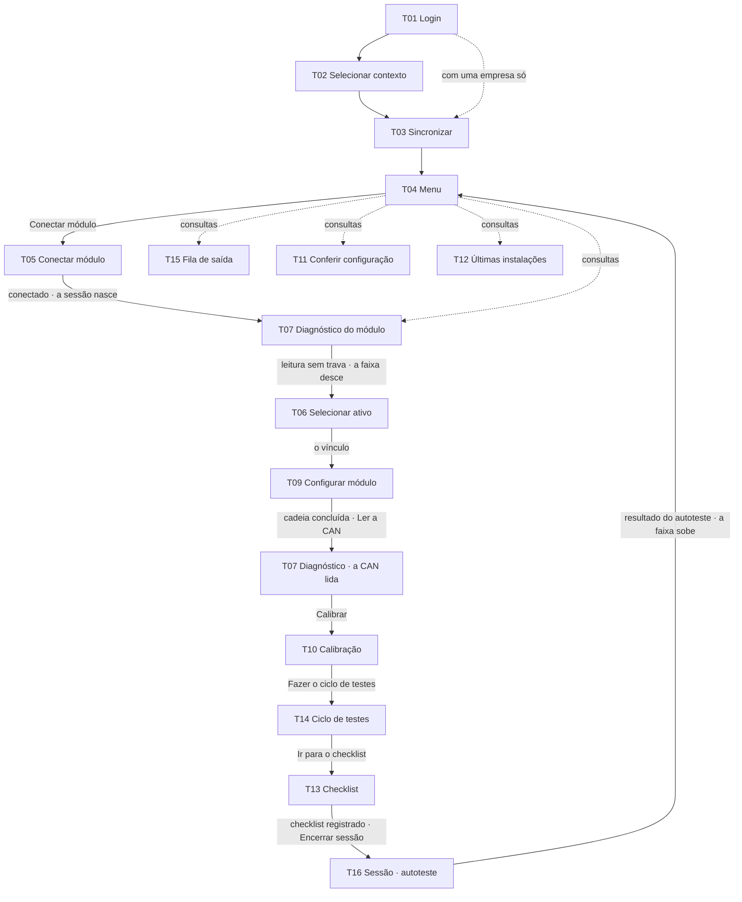

# Os fluxos

Este mapa descreve o produto e o percurso normal do protótipo. Os cenários especiais expostos pelo palco são consultas paradas em *Estados desta tela*, com retorno ao fluxo anterior; não são atalhos para percursos de demonstração diferentes.

## O caminho feliz

**Em palavras:** entrar, escolher a empresa (com uma só, o app pula a escolha), baixar o pacote dela e chegar ao menu. Do menu, conectar o módulo (é na conexão que **a sessão nasce**), ver o diagnóstico do módulo, escolher o ônibus e confirmar o vínculo, conferir o que vai ser gravado e gravar a cadeia. Daí em diante, **o caminho segue sem voltar ao menu**: a cadeia concluída leva à CAN (*Ler a CAN*), que o bloco do ativo acabou de liberar; a CAN lida leva à calibração (*Calibrar*); a calibração, ao ciclo com o veículo parado (*Fazer o ciclo de testes*); e o ciclo concluído, ao checklist (*Ir para o checklist*). Com o checklist registrado, **encerrar a sessão**: a T16 reinicia o módulo, relê e apresenta o autoteste, e só depois desse resultado aparece a homologação. Em cada uma, o *Voltar ao menu* continua, no rodapé ou no voltar do Android, pra quem precisa de outra ferramenta. A fila, a conferência e as últimas instalações são **consultas**: abrem pelo menu quando disponíveis.

A T07 aparece duas vezes no diagrama porque o técnico passa duas vezes por ela: logo depois de conectar, pro módulo, e depois da configuração, pra CAN. É a mesma tela, sem tela nova.

**No percurso do herói:** o técnico escolhe entre três empresas, e a Viação Atlântico Sul tem os dados navegáveis desta demonstração: os 24 ativos do mock. O M2C-0417 é vinculado ao RKT-8H42. Depois da cadeia, a CAN do ônibus lê os seis sinais da biblioteca do modelo (*14 de 14*, com os oito do módulo). Na T10, *Nada a calibrar neste ativo*: rotação e hodômetro vêm direto do veículo. O ciclo da T14 tem quatro passos — ignição ligada, rotação, cartão e ignição desligada — e o evento de teste. O cartão é comparado pelo técnico com o número impresso. O bip do leitor é respondido no checklist. Ré, porta, deslocamento e velocidade não são passos desse ciclo.

**Ao concluir a T14:** *Ir para o checklist* continua a instalação na T13; *Voltar ao menu* permite acessar outra ferramenta, preservando os resultados. Nenhum desses botões homologa nem encerra a sessão.

## Os desvios, por etapa

| Etapa | O desvio | Pra onde vai |
|---|---|---|
| entrar | usuário ou senha incorretos | fica no login, com o aviso |
| entrar | esqueci a senha | canal → código → nova senha → senha alterada → login |
| entrar | código errado · expirado · tentativas esgotadas | fica no código, com o motivo e o que fazer |
| entrar | não recebi o código, no teto dos envios da hora | a folha diz por que as duas saídas esperam e a hora em que liberam (T01/23) |
| contexto | pacote de 3 a 7 dias | avisa e deixa continuar |
| contexto | pacote de mais de 7 dias | bloqueia até sincronizar |
| sincronizar | a rede cai no meio da baixa, com o pacote do aparelho valendo | segue com ele: `Continuar com o pacote de ontem` (T03/01) |
| sincronizar | a rede cai, e o pacote do aparelho venceu | `Reconectar` ou `Trocar de empresa` (T03/05) |
| menu | sem rede | tudo continua de pé; só as últimas instalações esperam |
| menu | o módulo da sessão perde o link | o cartão do módulo reconecta; as ferramentas que precisam dele esperam (T04/03 e 18) |
| menu | sair da conta | sempre pergunta: conta o que fica na fila, encerra a sessão antes e diz que entrar de novo precisa de rede (T04/06, 17 e 20) · com o checklist registrado, o encerramento antes é o completo da T16, com o reinício e o autoteste (T04/20) |
| menu | trocar de empresa | o toque marca, e o `Sincronizar` troca, como na T02 (T04/07 e 21) · com o checklist registrado, o encerramento completo da T16 vem antes da troca |
| conectar | o módulo não tem Bluetooth (o VL06 ECO e o VL06 CAN) | não aparece na busca · o vazio avisa |
| conectar | o celular não confirma o pareamento | diz o que houve, e `Tentar de novo` (T05/20) |
| conectar | o reconectando não volta no tempo limite | a conexão falhou (T05/04) |
| conectar | voltar da busca, que não tem saída pro menu no rodapé | o voltar do Android leva ao menu |
| diagnóstico | serial fora do cadastro · modelo sem suporte | a linha trava, com o motivo no aviso |
| diagnóstico | firmware não homologado | com rede no módulo, atualiza e relê; sem rede, grava a conexão antes da atualização |
| diagnóstico | a atualização do firmware para no meio | diz onde parou, e `Tentar de novo` ou `Procurar outro módulo` (T07/14) |
| diagnóstico | modem sem sinal · uma leitura fora | só informa — o checklist registra |
| diagnóstico | um sinal da CAN sem leitura ou fora do esperado | a linha diz o que leu, e o caminho segue: não trava (T07/08 e 09) |
| ativo | o ônibus é de outra empresa do técnico | trocar de empresa pra instalar nele (T06/04) |
| ativo | o módulo está em outro ativo | conferir a etiqueta · desvincula e vincula aqui · o desvínculo fica registrado (T06/10) |
| ativo | o módulo já é deste ativo | é manutenção: um bloco por vez |
| configurar | o módulo tem mensagens que ainda não enviou | a folha pergunta antes da limpeza: esperar o envio, que aparece contando (T09/29), ou gravar mesmo assim |
| configurar | não cabe · cercas demais | a gravação não começa: nenhum módulo do modelo guarda mais · procurar outro módulo encerra e volta à busca |
| configurar | bloco recusado · queda | tenta de novo **do mesmo bloco** |
| configurar | recusado de novo | `Gravar só a conexão e encerrar`, que pergunta antes (T09/31 a 33) |
| configurar | a queda não volta no tempo limite | o que conferir e a quem acionar (T09/35) |
| configurar | o servidor ainda não respondeu | conferir o chip e o lugar do módulo, e `Conferir de novo` (T09/12) |
| configurar | tentar sair no meio | a recuperação segura até a Conexão gravar |
| conferir | voltar da conferência com divergência (T11/00) | o voltar registra o diagnóstico e volta ao menu, como o `Apenas registrar o diagnóstico` |
| calibrar | o número digitado errado | o painel semeado se toca pra corrigir (T10/01, 09 e 12) |
| ciclo | prazo do evento estourado | dispara outro — os passos continuam valendo |
| ciclo | o cartão não confere | `Passar de novo` (T14/10) |
| checklist | Seção F falhando | `Disparar de novo` (T13/49), ou finaliza com a ciência do técnico, com nome e hora |
| checklist | o bip não ouvido | só conta com o que aconteceu escrito, e `Testar de novo` refaz (T13/42 e 50) |
| checklist | voltar com a ressalva começada | pergunta antes de jogar fora (T13/51) |
| encerrar | ENCERRAR antes de registrar o checklist | confirma no diálogo; encerrando mesmo assim, a sessão abortada executa 4 passos |
| encerrar | o módulo que não reinicia por comando (o VL08) | pede o corte da alimentação, uma vez (T16/09) |
| encerrar | o módulo não volta do reinício | `Tentar de novo` ou `Encerrar sem homologar` (T16/10) |
| encerrar | uma assertiva falha | a homologação bloqueia, com a causa e a quem acionar; o encerramento não |
| encerrar | descartar a sessão interrompida | pergunta antes; o módulo zerado e sem a conexão ganha a conexão antes do descarte (T16/11) |
| fila | sem rede | o `Ressincronizar` espera a rede, apagado (T15/05) |

No protótipo (decisão 36): antes de registrar o checklist, o diálogo *Encerrar antes de terminar?* vem antes: `Continuar a instalação` fecha e deixa o técnico na tela; `Encerrar mesmo assim` roda os 4 passos da sessão abortada. Com o checklist registrado e aguardando autoteste, o ENCERRAR leva diretamente ao encerramento completo da T16. Algumas notas históricas chamavam esse registro de *homologado*; a palavra agora fica só no resultado da T16 (`06-prototipo/logica.md` · ENCERRAR).

No protótipo (decisão 44): a sessão nasce na conexão, mas **a faixa desce na T07**, quando a leitura do módulo termina sem trava. O diagnóstico tem nove linhas, oito contadas; mensagens pendentes só informam. Numa trava, o módulo fica em cima do título, sem faixa (`02-telas/T07-diagnostico-do-modulo/tela.md` · Chrome).

No protótipo (procurar outro módulo): na T07, `Procurar outro módulo` volta à busca da T05, com nada escolhido (`T05/01`) · na T09, a sessão já está aberta, e ele abre o diálogo *Encerrar antes de terminar?*: o `Encerrar mesmo assim` roda os 4 passos da sessão abortada e segue pra busca, a T05/01, como o da T07.

No protótipo (o painel do palco): a T07 fica só no caminho, depois da T05 · as consultas do painel são a T15, a T11 e a T12 (`06-prototipo/palco/referencias/html/04-painel-aberto.html`). A seta pontilhada do menu pra T07, no diagrama, é o cartão *Diagnóstico do módulo*.

Cada condição tem a sua referência em `02-telas/<tela>/estados.md`. A existência da referência não torna o quadro um percurso interativo no palco: os exemplos de manutenção (T09), calibração do caminhão (T10), divergência (T11) e releitura de alimentação (T13) foram reunidos como consultas paradas. No painel e no endereço simples da tela, T02, T10 e T11 seguem o mesmo contexto do percurso normal. *Voltar ao fluxo* restaura o que estava aberto antes da consulta.
