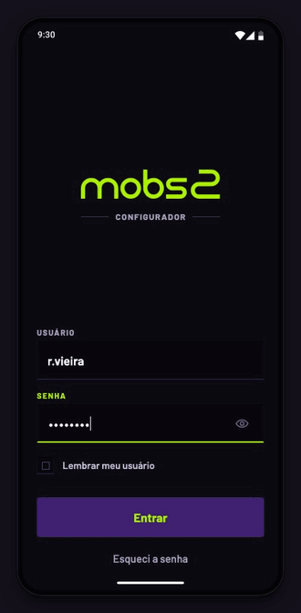
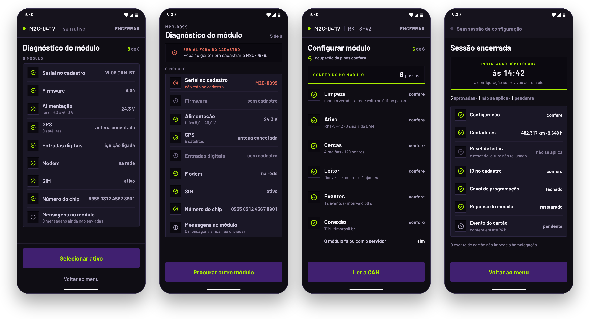
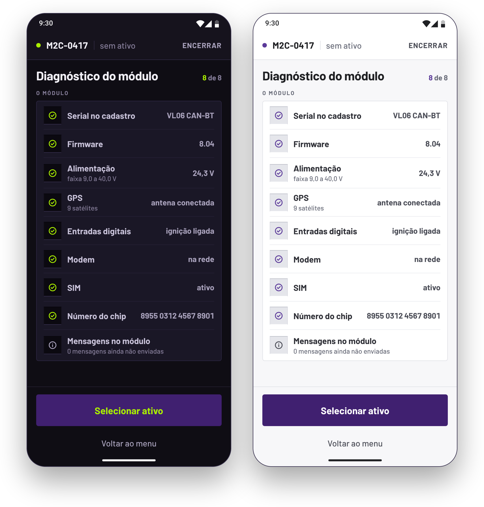
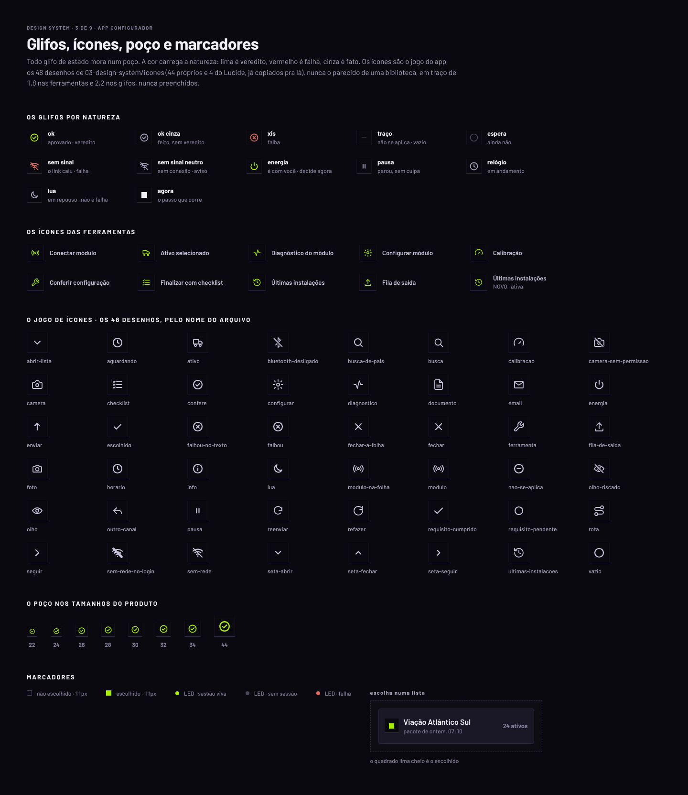

# Configurador Mobs2 · App

**Design de produto e design engineering de um app mobile para o técnico de campo instalar, configurar e homologar módulos de telemetria em ônibus e caminhões.** Do problema ao protótipo navegável em código, com o design system, as 230 referências desenhadas e o handoff para o desenvolvimento.

> **Isto é um protótipo, não o produto.** O app daqui roda no navegador, com dados de exemplo e sem módulo, servidor ou Bluetooth de verdade. Ele é a especificação viva do produto: o comportamento, os textos e o desenho de cada tela.
>
> Projeto da **MOBS2**, publicado com autorização da empresa para portfólio. Veja [Créditos e uso](#créditos-e-uso).

<p align="center">
  
</p>

<p align="center"><b><a href="https://configurador-mobs2-prototipo.vercel.app">Abrir o protótipo →</a></b></p>

## Em números

| telas | referências desenhadas | tokens | peças do design system | roteiros de navegação | decisões registradas |
|---|---|---|---|---|---|
| 15 | 230 | 318 | 117 | 51 | 64 |

As 230 referências são 15 telas, 129 momentos e 86 estados. O design system tem dois temas, 48 ícones próprios e 9 folhas. O produto tem 110 histórias de usuário, e os dados de exemplo, 69 casos.

## O papel no projeto

**Luiz Felipe Silva Correia**, designer de produto, fez:

- **o design do produto:** o fluxo, as 15 telas e cada estado de erro, espera e manutenção, a partir dos requisitos e das revisões com o gerente de produto;
- **o design system:** os tokens, as leis visuais e de movimento, as 117 peças, os ícones e os dois temas;
- **o protótipo em código:** dirigindo um agente de IA com regras, medição e aprovação, do primeiro token à publicação;
- **o handoff:** as fichas de cada tela, os testes prontos e o guia para levar o design system a outra plataforma.

O protótipo completo levou quatro dias, de 24 a 27/09/2026. As revisões de produto vieram de 02 a 23/10, em sete versões.

## O problema

O técnico de campo é terceirizado e não conhece a lógica de programação do módulo. Ele instala em pátio, obra e zona rural, muitas vezes sem rede, às vezes embaixo do ônibus. E o equipamento não avisa quando algo dá errado. **Sucesso de comando não é sucesso de configuração**: um bloco pode ser aceito e não funcionar, e um erro de faixa apaga em silêncio e só aparece dias depois. O checklist antigo era uma lista de 30 itens marcáveis à mão, com um "marcar todos" que permitia homologar sem verificar.

## A resposta

**O sistema decide e o técnico executa.** Todo envio é confirmado por releitura do módulo, e **a evidência é gerada pelo app, não digitada pelo técnico.** O técnico só responde o que só um humano vê, e com foto.

O app conduz a instalação em sequência e prova cada passo:

1. **Sincroniza** o pacote da empresa (os ônibus, as conexões, os modelos, os eventos e as cercas) pra trabalhar mesmo sem rede.
2. **Conecta** ao módulo por Bluetooth: pareia na primeira vez e reconecta sozinho quando a conexão cai.
3. **Diagnostica** o módulo: serial, firmware, alimentação, GPS, entradas, modem e SIM. Um módulo fora do cadastro ou sem suporte trava a instalação ali.
4. **Vincula** o módulo ao ônibus, confirmado pela placa, frota, fabricante e modelo.
5. **Grava a configuração** em seis blocos, mostrando cada etapa gravando e conferindo no módulo. Na manutenção, reenvia um bloco por vez e avisa o que depende dele.
6. **Lê a CAN e calibra** só o que ela não entrega: o ônibus não calibra nada; o caminhão coletor calibra o hodômetro e a rotação.
7. **Roda o ciclo de testes** com o ônibus parado: ignição, rotação e cartão do motorista. A cada passo, o app diz o que fazer e confere o resultado.
8. **Fecha o checklist**: o app confere sozinho o que consegue, e o técnico fotografa o resto, confere cada foto antes de usar e testa o bip do leitor. Ao encerrar, o módulo reinicia, o autoteste confere a instalação, e só aí ela é homologada.

<p align="center">
  
</p>
<p align="center"><sub>O diagnóstico do módulo · a falha no lugar dela, com a ação · a configuração relida do módulo · a instalação homologada depois do autoteste</sub></p>

## As escolhas de design

- **A evidência é gerada, nunca digitada.** Tudo o que o sistema pode provar, ele prova: a releitura, a CAN, o evento de teste, o autoteste. ([decisão 01](07-decisoes/01-evidencia-gerada.md))
- **O estado muda o conteúdo, nunca o desenho.** Num erro, os blocos ficam onde estão e muda o que eles dizem: o técnico nunca perde o lugar. ([decisão 05](07-decisoes/05-nada-se-remonta.md))
- **A falha mora no elemento.** O bloco que falhou acende em vermelho, com a causa e a ação ao lado, e o título da tela continua o mesmo. ([decisão 04](07-decisoes/04-falha-no-elemento.md))
- **Uma cor só pra verdade.** O lima marca o que foi julgado, o que foi escolhido e o botão principal. Ele nunca decora. ([decisão 03](07-decisoes/03-lima-veredito.md))
- **Toda espera tem fim.** Cada processo tem um desfecho que diz o que aconteceu e o que fazer, e nenhum botão aceso deixa de responder. ([decisão 64](07-decisoes/64-toda-espera-tem-fim.md))
- **Dois temas, um desenho.** O escuro é o padrão: o app é usado no pátio, na garagem e embaixo do ônibus, com a identidade de um painel de instrumentos. O claro é escolha do técnico e nasce dos mesmos tokens: só as cores mudam. ([decisão 02](07-decisoes/02-so-escuro.md))

<p align="center">
  
</p>

As 64 decisões, cada uma com o contexto, o que foi descartado e a consequência, estão em [`07-decisoes/`](07-decisoes/).

## Do desenho ao código

O protótipo não imita o design: ele é o design rodando.

- **O design system em código.** Os 318 tokens são CSS, e o tema claro nasce do escuro trocando só as cores. As 117 peças são componentes React construídos no projeto, sem biblioteca de fora, e uma vitrine fotografa cada uma contra as folhas do design system. Os tokens também saem em JSON, no formato de tokens de design, pra qualquer outra plataforma.
- **A fidelidade medida.** Cada uma das 230 referências é fotografada no Chrome sem tela e comparada pixel a pixel com o PNG desenhado. Toda diferença que sobra tem um nome e um motivo, na ficha da tela.
- **Os testes de navegação.** 51 roteiros andam pelo app tocando pelos nomes acessíveis, como o técnico faria. O caminho principal tem 250 passos, do login à instalação homologada.
- **Mesma entrada, mesma saída.** O relógio fica parado em 14:30, e nada é aleatório. Cada print é reproduzível, e uma checagem reprova qualquer cor, medida ou relógio solto no código.
- **O movimento dentro das leis.** Os tempos e a curva saem dos tokens. Nada anima a entrada de tela, conta de zero ou gira em loop, e a opção de reduzir movimento é respeitada.

<p align="center">
  
</p>
<p align="center"><sub>Uma das nove folhas do design system: os glifos por natureza e o jogo dos 48 ícones próprios</sub></p>

**As tecnologias:** **React 18** e **Vite**, a fonte **Barlow**, a comparação visual com **pixelmatch** e a publicação na **Vercel**.

## O método com IA

O protótipo foi construído por um agente de IA (Claude Code) sob a direção do designer, a partir de um design já fechado. O agente constrói o que está descrito, sem redesenhar. Cada ciclo começa com um plano, com o que foi medido e as decisões em aberto, e só constrói depois da aprovação. Quando a realidade impede a especificação, a diferença é registrada com o motivo.

As regras que governam o agente estão no [`CLAUDE.md`](CLAUDE.md), e o método inteiro, no [`PROCESSO.md`](PROCESSO.md).

## O protótipo

O protótipo roda no navegador e anda só por toque, do login ao encerramento. No computador, o celular aparece em tamanho real dentro de um palco:

- o quadrado no canto abre o painel com as 15 telas;
- a coluna **Estados desta tela** oferece os exemplos parados (erros, manutenção, calibração do caminhão e outras condições), montados pelos dados de exemplo. O toque não avança esses quadros; **Voltar ao fluxo** devolve o percurso guardado;
- cada tela, momento e estado tem um link próprio (`?tela=T07&estado=02-estado-serial-nao-cadastrado`).

No celular, o app ocupa a tela inteira.

## O handoff

O projeto foi entregue ao desenvolvimento com uma ficha por tela (o comportamento, os estados, os textos exatos e as animações), o design system pronto em CSS e JSON, os testes de navegação, o guia de comparação contra o desenho e as regras que valem em todas as telas. O protótipo é a especificação viva: cada estado tem link próprio, e o dev abre a tela exata. O guia está em [`08-handoff/`](08-handoff/README.md).

## O material do projeto

| O quê | Onde |
|---|---|
| o GIF do caminho principal | [`05-recursos/readme/caminho-do-heroi.gif`](05-recursos/readme/caminho-do-heroi.gif) |
| as telas e os dois temas, em imagem | [`05-recursos/readme/`](05-recursos/readme/) |
| a imagem de capa, em 1280 × 640 | [`05-recursos/readme/previa-social.png`](05-recursos/readme/previa-social.png) |
| as 9 folhas do design system | [`03-design-system/referencias/png/`](03-design-system/referencias/png/) |
| as 26 telas no tema claro | [`03-design-system/claro-amostras/`](03-design-system/claro-amostras/) |
| cada tela, momento e estado, em PNG | `02-telas/*/referencias/png/` |
| o produto em uma página | [`01-produto/historia.md`](01-produto/historia.md) |
| quem usa | [`01-produto/usuario.md`](01-produto/usuario.md) |
| os princípios e o vocabulário | [`01-produto/dominio.md`](01-produto/dominio.md) |
| os fluxos | [`01-produto/fluxos.md`](01-produto/fluxos.md) |
| as decisões | [`07-decisoes/`](07-decisoes/README.md) |
| o método | [`PROCESSO.md`](PROCESSO.md) |
| as versões, com as datas | [`CHANGELOG.md`](CHANGELOG.md) |

## O repositório

```
01-produto/          por que existe, pra quem, os princípios, as histórias e os fluxos
02-telas/            uma pasta por tela: ficha, estados, animação, textos e as referências
03-design-system/    tokens (os dois temas), leis, movimento, componentes, os ícones e as nove folhas
04-dados/            os dados de exemplo e a checagem que os confere
05-recursos/         a marca, a fonte e o cenário do sistema
06-prototipo/        o protótipo navegável, o palco e as ferramentas de verificação
07-decisoes/         o porquê de cada escolha, com o que foi descartado
08-handoff/          o handoff de design: as regras de todas as telas, os testes e a comparação
```

A ordem de leitura de cada perfil está no [`GUIA-DE-LEITURA.md`](GUIA-DE-LEITURA.md).

## Rodar localmente

```bash
cd 06-prototipo/app
npm install
npm run dev
```

Abre em `http://localhost:5173`. Na mesma pasta, rode `npm run checar` para conferir o mock e as regras do código, e `npm run build` para gerar o build. Os testes de navegação e a comparação visual estão nos [testes prontos](08-handoff/testes-prontos.md).

## Créditos e uso

**Autoria:**
- design de produto, design system e protótipo por [Luiz Felipe Silva Correia](https://www.linkedin.com/in/lfelipe-scorreia/);
- requisitos e regras de negócio por [Thacyo Lima](https://www.linkedin.com/in/thacyo-lima-135a45140/), Gerente de Produtos da MOBS2;
- validação do protótipo e priorização do backlog para o desenvolvimento por [Bruno Santana](https://www.linkedin.com/in/brunosantana610/), na MOBS2.

**Uso:** o produto, o design e o código são da **MOBS2 COMERCIO E SERVICOS LTDA - EPP**, que autorizou a publicação deste repositório como portfólio. O conteúdo é para consulta: usar em outro produto, copiar ou distribuir depende de autorização da empresa. Os termos estão no [`LICENSE`](LICENSE).

**O que é de terceiros** segue a licença de cada um:
- as fontes **Barlow** e o recorte da **Google Sans**, sob a SIL Open Font License 1.1, com o texto da licença em [`05-recursos/fontes/`](05-recursos/fontes/);
- os desenhos de oito ícones que vêm do **Lucide** (quatro do app e os quatro do palco), sob a licença ISC;
- as barras do sistema, do kit do **Material 3**, do Google;
- o teclado numérico do sistema, desenhado nas medidas do Gboard do **Material 3**, com os números da **Roboto** e três ícones do **Material Icons**, do Google, sob a licença Apache 2.0.
